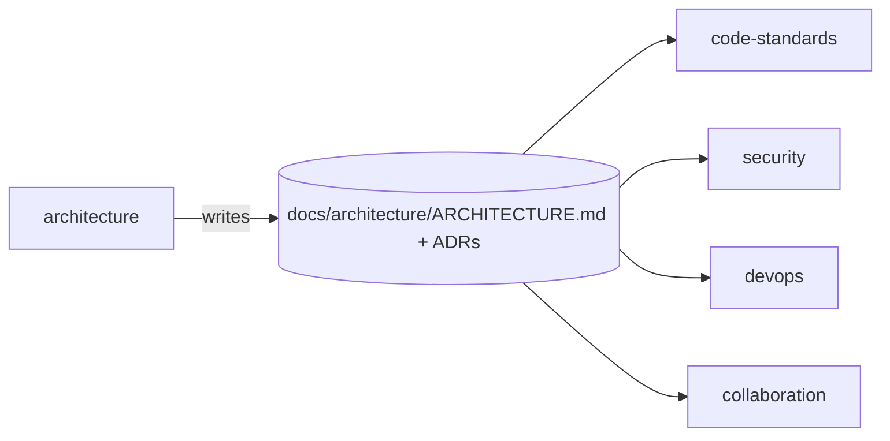
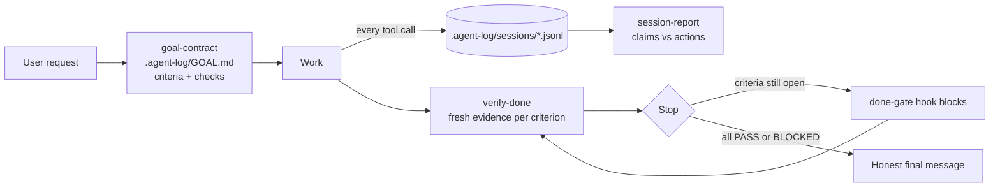

# agent-skills

My engineering standards, written as Claude Code skills. Every project I start installs them, so every project gets the same architecture discipline, code standards, security baseline, delivery pipeline, and team workflow.

## Install — once per machine, works in every project

```bash
claude plugin marketplace add ebuka-odih/agent-skills
claude plugin install agent-ops@ebuka-skills
claude plugin install architecture@ebuka-skills
```

Working on the skills from a local clone? Run `claude plugin marketplace add ./` from the repo root instead.

Pull updates:

```bash
claude plugin marketplace update ebuka-skills
```

## How it's organised

Three levels. An agent reads only as deep as the task needs.

```
plugins/<domain>/                  level 1 — a domain, installed as one plugin
└── skills/<skill>/                level 2 — one job, triggers on its own
    ├── SKILL.md                   the workflow: steps, outputs, hard rules (short)
    ├── references/<topic>.md      level 3 — decision tables, loaded only when a step needs them
    └── templates/<file>.md        files the skill fills into the project
```

Each domain has an **orchestrator** skill that runs the whole flow and hands deep questions to its sibling skills. Each sibling also triggers alone — asking "JWT or sessions?" loads `auth-design` without the rest.

## The contract between domains

`architecture` writes `docs/architecture/ARCHITECTURE.md` in the project. Every other domain reads it first.



## Domains

| Plugin | Status | Skills |
|---|---|---|
| `agent-ops` | ✅ 0.1 | `agent-ops` (orchestrator) · `goal-contract` · `verify-done` · `session-report` + logging and done-gate hooks |
| `architecture` | ✅ 0.2 | `system-design` (orchestrator) · `repo-and-services` · `auth-design` · `data-design` · `api-design` · `adr` |
| `code-standards` | planned | see [ROADMAP.md](ROADMAP.md) |
| `security` | planned | builds on [Cloudflare's security-audit skill](UPSTREAM.md) |
| `devops` | planned | |
| `collaboration` | planned | git workflow, commits, PRs, code review |

## What `architecture` does in a project

1. Asks ≤ 6 questions about drivers: scale, team, constraints, uptime, stack.
2. Walks 18 decision areas — repo shape, services, auth, data, APIs, async, infra, observability, security, testing, cost.
3. Writes `docs/architecture/ARCHITECTURE.md` with Mermaid diagrams, plus an ADR per costly decision.
4. Later, in **Check** mode, reviews a PR against the doc and flags boundary violations with file:line.

House defaults live in [`plugins/architecture/skills/system-design/references/defaults.md`](plugins/architecture/skills/system-design/references/defaults.md). Edit that file to change what gets recommended.

## What `agent-ops` does in a project — closing the "said done ≠ actually done" gap



- **Logs everything** via hooks: prompts, every tool call (ok/failed, output excerpt, secrets redacted), final claims, gate blocks. One JSONL file per session in `.agent-log/sessions/` (gitignored by default).
- **Goal contract**: before work, the request is written down verbatim with checkable acceptance criteria.
- **Done-gate**: a Stop hook refuses to let the agent end its turn while criteria are unverified. It blocks once per attempt, so it can't loop. `AGENT_OPS_GATE=off` disables it.
- **Session report**: `bash plugins/agent-ops/scripts/report.sh .agent-log/sessions/<file>.jsonl` lists failures, files touched, and gap signals like "claims tests pass but none ran after the last edit".

## Testing the skills

Two layers. Both must pass before bumping a version.

| Layer | What it proves | Run |
|---|---|---|
| Script tests | Hooks log correctly, redact secrets, gate blocks/releases | `bash plugins/agent-ops/tests/run.sh` |
| Skill evals | A real agent with the plugin does what SKILL.md promises, compared with the same agent without it | `cd plugins/<domain> && claude plugin eval . --allow-tools Write Edit Bash --no-publish` |

### Latest results — 2026-11-05 (Claude Opus 5.5)

| Case | With plugin | Without | What it shows |
|---|---|---|---|
| agent-ops · goal-then-verify | **1.0** | 0.1 | Goal written before code, tests re-run, honest final status, session logged |
| architecture · design-new-project | **0.875** → fixed grader | 0.0 | Full ARCHITECTURE.md + ADRs following house defaults |
| architecture · check-mode | 1.0 | 1.0 | Catches planted boundary violations with file:line |
| architecture · microservices-pushback | 1.0 | 1.0 | Recommends modular monolith for a 2-person team |
| architecture · auth-question | 1.0 | 1.0 | Per-client auth advice (skill did not fire — model answered directly) |

Where both arms score 1.0, the base model already knows the general advice. Next step for those cases: test house-specific rules from `defaults.md` that a model without the plugin can't guess.

The first agent-ops run scored 0.3: logging worked, but the agent never chose to write a goal. That's the "said done ≠ goal" gap in practice. The fix was enforcement through hooks (`goal-nudge` + done-gate rule 2), not better wording.

Eval cases live in `plugins/<domain>/evals/<case>/` — `prompt.md` (the task) + `graders/*.md` (skill fired, files written, regex on contents, LLM-judged quality).

## Contributing / extending
See [CLAUDE.md](CLAUDE.md) for authoring rules, [ROADMAP.md](ROADMAP.md) for what's next, [UPSTREAM.md](UPSTREAM.md) for third-party skills we use or learn from.
