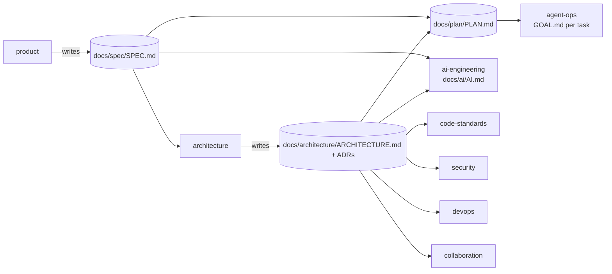
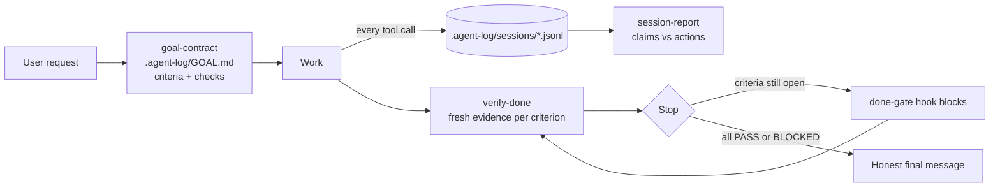

# agent-skills

My engineering standards, written as Claude Code skills. Every project I start installs them, so every project gets the same architecture discipline, code standards, security baseline, delivery pipeline, and team workflow.

## Install — once per machine, works in every project

```bash
claude plugin marketplace add ebuka-odih/agent-skills
claude plugin install product@ebuka-skills
claude plugin install agent-ops@ebuka-skills
claude plugin install architecture@ebuka-skills
claude plugin install ai-engineering@ebuka-skills
claude plugin install collaboration@ebuka-skills
claude plugin install code-standards@ebuka-skills
claude plugin install security@ebuka-skills
claude plugin install testing@ebuka-skills
claude plugin install devops@ebuka-skills
claude plugin install frontend@ebuka-skills
claude plugin install seo@ebuka-skills
```

Working on the skills from a local clone? Run `claude plugin marketplace add ./` from the repo root instead.

Pull updates:

```bash
claude plugin marketplace update ebuka-skills
```

## How it's organised

Three levels. An agent reads only as deep as the task needs.

```
plugins/<domain>/                  level 1 — a domain, installed as one plugin
└── skills/<skill>/                level 2 — one job, triggers on its own
    ├── SKILL.md                   the workflow: steps, outputs, hard rules (short)
    ├── references/<topic>.md      level 3 — decision tables, loaded only when a step needs them
    └── templates/<file>.md        files the skill fills into the project
```

Each domain has an **orchestrator** skill that runs the whole flow and hands deep questions to its sibling skills. Each sibling also triggers alone — asking "JWT or sessions?" loads `auth-design` without the rest.

## The contract between domains

`architecture` writes `docs/architecture/ARCHITECTURE.md` in the project. Every other domain reads it first.



## Domains

| Plugin | Status | Skills |
|---|---|---|
| `product` | ✅ 0.1 | `product` (orchestrator) · `product-spec` · `project-plan` · `next-task` + session-start hook |
| `agent-ops` | ✅ 0.1 | `agent-ops` (orchestrator) · `goal-contract` · `verify-done` · `session-report` + logging and done-gate hooks |
| `ai-engineering` | ✅ 0.1 | `ai-design` (orchestrator) · `ai-feature` · `ai-stack` · `ai-evals` · `ai-safety` · `ai-ops` · `ai-learnings` + session-start drift hook |
| `architecture` | ✅ 0.2 | `system-design` (orchestrator) · `repo-and-services` · `auth-design` · `data-design` · `api-design` · `adr` |
| `code-standards` | ✅ 0.1 | `writing-code` (orchestrator) · `structure-and-naming` · `error-handling` · `testing` · `refactoring` + leftover-scan hook |
| `testing` | ✅ 0.1 | `test-strategy` (orchestrator) · `mutation-testing` · `property-based` · `contract-testing` · `e2e-testing` · `non-functional` (load, a11y, visual) |
| `security` | ✅ 0.1 | `security-baseline` (orchestrator) · `secure-coding` · `threat-model` · `secrets-and-deps` · `security-audit` (→ [Cloudflare's skill](UPSTREAM.md)) + secret guard hook |
| `frontend` | ✅ 0.1 | `ui-system` (orchestrator) · `shadcn-tailwind` · `dashboard-patterns` · `ui-consistency` · `component-testing` · `frontend-performance` + token hook |
| `seo` | ✅ 0.2 | `seo-architecture` (orchestrator) · `keyword-research` · `search-console` · `page-speed` · `site-audit` · `on-page` · `structured-data` · `programmatic-seo` · `international` + built-site scanner, live crawler, Search Console and PageSpeed reports |
| `devops` | ✅ 0.1 | `delivery-pipeline` (orchestrator) · `ci` · `environments` · `infrastructure-as-code` · `observability` · `release-and-rollback` + infra guard hook |
| `collaboration` | ✅ 0.1 | `git-workflow` (orchestrator) · `commits` · `pull-requests` · `code-review` · `repo-setup` + git guard hook |

## What `architecture` does in a project

1. Asks ≤ 6 questions about drivers: scale, team, constraints, uptime, stack.
2. Walks 18 decision areas — repo shape, services, auth, data, APIs, async, infra, observability, security, testing, cost.
3. Writes `docs/architecture/ARCHITECTURE.md` with Mermaid diagrams, plus an ADR per costly decision.
4. Later, in **Check** mode, reviews a PR against the doc and flags boundary violations with file:line.

House defaults live in [`plugins/architecture/skills/system-design/references/defaults.md`](plugins/architecture/skills/system-design/references/defaults.md). Edit that file to change what gets recommended.

## What `product` does — long projects, one task at a time

| | Spec | Plan | Goal |
|---|---|---|---|
| File | `docs/spec/SPEC.md` | `docs/plan/PLAN.md` | `.agent-log/GOAL.md` |
| Answers | What, for whom, what not | In what order | This task's checkable outcome |
| Lives | Whole project | Whole project, updated every task | One task |

1. **`product-spec`** interviews you in 3 short rounds (problem & users → journeys → limits). Each question comes with a proposed answer. It writes requirements `R1…` with priority and an `accept:` check, plus non-goals. Changes go through a change log.
2. **`project-plan`** cuts the spec into vertical-slice milestones (each one demoable) and small tasks: `- [ ] T7 · Cancel booking · covers: R7 · depends: T5 · size: M`.
3. **`next-task`** picks the first ready task, opens a GOAL.md linked to it (`task: T7`, `covers: R7`), builds it, verifies it, then ticks the task and writes a progress-log line.
4. **Session-start hook** tells every new session the active milestone, the task in progress, the next ready task and blockers, so no session starts from zero.
5. **`trace.sh`** reports project status and requirements with no task, tasks covering nothing, and tasks pointing at unknown requirements.

## What `ai-engineering` does — AI features that keep learning

1. **`ai-design`** reads the house AI defaults, the project's `LEARNINGS.md`, SPEC.md and ARCHITECTURE.md *first*, then asks only what's missing (3 short rounds: the job, the context, the limits). It writes `docs/ai/AI.md`: features, where AI code lives, model tiers, prompts, evals, safety, cost.
2. **`ai-feature`** writes one card per feature: pattern (extraction, classification, RAG, agent…), output schema, tier, prompt version, fallback (including a non-AI fallback), eval set, budget.
3. **`ai-stack`** builds it: Laravel AI SDK in-app, FastAPI + Pydantic AI, a split between them, or a mapped "other" stack. The API names are checked against the official docs.
4. **`ai-evals` · `ai-safety` · `ai-ops`** cover golden sets that gate merges, prompt-injection and tool-permission controls, and a usage row plus a budget alert for every call.
5. **`ai-learnings`** is the loop. Eval results, incidents, model swaps and spec changes become `LEARNINGS.md` entries, each with an action. Lessons seen across projects are promoted (with your approval) into `house-defaults.md`, which every new project reads first. The first defaults were seeded from two real projects (FastAPI + Pydantic AI).
6. **Session-start hook** flags AI projects with no AI.md, spec changes since the AI design, features with no card or eval set, and lessons waiting to be promoted.

## What `frontend` does — shadcn + Tailwind dashboards that stay consistent

Consistency comes from **few decisions reused everywhere**, not careful screens:

- **`ui-system`** sets the tokens: semantic colours via shadcn CSS variables (plus success/warning status tokens), a spacing rhythm, a type scale, radius and motion. It defines the component layers `components/ui` (shadcn primitives) → `components/app` (PageHeader, DataTable, StatCard, EmptyState…) → `features/*`, and writes `docs/ui/UI.md`.
- **`shadcn-tailwind`** covers `:root`/`.dark`/`@theme inline` theming, adding colours the shadcn way, `cn()`, cva variants, and the classes feature code never contains.
- **`dashboard-patterns`** covers page anatomy, TanStack Table with filters/sort/page in the URL, charts using `--chart-N`, StatCards, react-hook-form + zod, TanStack Query, and loading/empty/error states on every data view.
- **`ui-consistency`** reviews a screen or PR for drift (tokens, spacing, duplicate components, states, formats, a11y) and fixes it at the source.
- **`component-testing`** covers stories per state (both themes), Testing Library interactions by role, screenshots of stories, axe and MSW.
- **`frontend-performance`** sets Web Vitals and bundle budgets, fixes waterfalls, lazy-loads heavy libraries, and virtualises big tables.
- **`ui-scan.sh`** reports theme setup, component layers, drift counts per type with the top files, and missing tooling. On two real dashboards it found 400–1,400 raw colours and arbitrary values each, and no app-component layer.
- **The token hook** (non-blocking) flags `bg-blue-600`, hex/rgb literals, `p-[13px]` and `style={{…}}` as they're written, and names the token to use. shadcn primitives, stories, tests, `data-[…]` variants and `var()` values are exempt.

## What `seo` does — ranking built into the architecture

Technical SEO only; content and posting belong in a separate growth plugin later.

- **`seo-architecture`** reads SPEC.md and ARCHITECTURE.md, then picks the rendering per page type (prerender/SSR for public pages, never a client-only SPA), the URL scheme, the indexation policy and the sitemaps. It writes `docs/seo/SEO.md`.
- **`on-page`** covers the head of every page: one title, description, absolute self-canonical, one h1, Open Graph. Includes Blade, React and Next snippets.
- **`structured-data`** maps page types to schema.org types Google still shows (FAQ and HowTo rich results are gone) and builds JSON-LD from real data, never fake ratings.
- **`programmatic-seo`** covers generated pages (city × category): one `indexable()` function sets a threshold, and below it the page gets noindex,follow and stays out of the sitemap, so thin pages never get indexed.
- **`international`** covers locale subfolders, reciprocal hreflang + x-default, and localised currency and dates.
- **`keyword-research`** finds the searches you can win. It classifies intent, maps each cluster to exactly one URL, scores by demand × winnability × value, and flags cannibalization.
- **`search-console`** reads the Performance export. It finds striking-distance queries (positions 4–20) and titles with low CTR for their position, and diagnoses traffic drops by their shape, so a sudden sitewide cliff gets treated as an outage or indexing problem before anyone rewrites content.
- **`page-speed`** measures Core Web Vitals from real-user field data (p75 LCP, INP, CLS) plus Lighthouse lab data, and ranks fixes by estimated savings.
- **`site-audit`** crawls the live site like Googlebot: host variants, `robots.txt`, sitemaps, status codes, redirect chains, `X-Robots-Tag`, slow first byte and client-rendered shells. Then it runs the on-page checks on what it fetched.
- **Scripts:** `seo-crawl.sh <https://site>` · `gsc-report.sh <export.zip>` · `page-speed.sh <url>…` (`PSI_API_KEY` or `--lighthouse`). On two real sites the crawler found a homepage served as a JavaScript shell, duplicate hosts answering 200, and a CDN-managed `robots.txt` contradicting the site's own.
- **`seo-scan.sh <build-dir> --base https://example.com [--strict]`** audits the built HTML: titles, descriptions, canonicals, h1, lang, OG, JSON-LD validity, hreflang reciprocity, site-wide duplicates, `robots.txt` blocks and sitemap coverage. `--strict` fails CI on errors.

## What `devops` does — PR to production, reversibly

- **`delivery-pipeline`** defines the stages (PR checks → preview → staging → production, promoting the same artifact) and the gates at each one. The gates come from the other domains: tests, test-strategy, dependency audit, secret scan, AI evals and PR rules. It writes `docs/ops/DELIVERY.md`.
- **`ci`** sets the rules (frozen installs, least-privilege `permissions:`, pinned actions, concurrency, < 10 min) and ships templates for **Laravel**, **FastAPI (uv)** and **Node/React**.
- **`environments`** covers local / preview / staging / production, config vs secrets, `.env.example`, staging in provider test mode, and failing fast on missing config.
- **`infrastructure-as-code`** covers platform choice (Laravel Cloud/Forge, Dokploy, PaaS, Terraform), production Dockerfiles (multi-stage, non-root) and the plan → review → apply flow.
- **`observability`** covers structured logs with request IDs, RED metrics, OpenTelemetry traces, `/health` and `/ready`, SLOs from spec targets, and burn-rate alerts routed to a person.
- **`release-and-rollback`** covers rolling, blue/green or canary deploys, expand → migrate → contract migrations, feature flags, a RELEASE.md template and an incident runbook.
- **`devops-scan.sh`** reports CI gaps (tests, lint, types, audit, secret scan, frozen installs, unpinned actions, permissions), the deploy target, root-running Dockerfiles, IaC and a missing health endpoint.
- **The infra guard hook asks first** before `terraform destroy` or `apply -auto-approve`, `migrate:fresh`/`db:wipe`/`rollback`, DROP/TRUNCATE/FLUSHALL, volume deletes, `compose down -v`, kubectl delete/scale in prod, platform app deletes and production deploys.

## What `testing` does — the right tests for the conditions

Every change gets the base layer from `code-standards:testing` (unit + feature tests; bug fix → failing test first). `test-strategy` adds a technique only when its condition holds:

| Condition | Adds |
|---|---|
| Pure logic over many inputs (money, dates, parsing) | property-based (Hypothesis, fast-check) |
| Critical rule (payments, pricing, permissions, tenancy) | mutation testing on changed files (Pest `--mutate`, Infection, mutmut, Stryker), MSI gate |
| Public/partner API or service boundary | contract (oasdiff, Schemathesis, Pact) |
| Must-have SPEC journey | a few Playwright E2E tests |
| SPEC NFR latency/throughput | k6 load test on staging with thresholds |
| UI change | component + accessibility (axe); shared components → visual regression |

- **`test-plan.sh`** reads the diff and SPEC.md NFRs and prints a per-file plan plus the reasons, skipping docs, config and binaries.
- **`test-tools.sh`** reports which of these tools each folder already has, with install hints.
- **Budget rules** keep CI fast: mutation and contract checks run on changed files in PRs, load tests run nightly, the E2E smoke run stays ≤ 5 min. Thresholds apply to changed code, not the whole legacy codebase.

## What `security` does — baseline, reviews, threat models, audits

- **`security-baseline`** walks a checklist (identity, input/output, transport, secrets and deps, data, AI, operations). Each control is marked in place (with evidence), N/A, or a gap with severity and owner, and recorded in `docs/security/SECURITY.md`.
- **`secure-coding`** maps OWASP checks to rules for Laravel, FastAPI and React. Findings are reported as `file:line · class · exploit in one sentence · fix`, and every fix gets a regression test.
- **`threat-model`** is STRIDE-lite per feature: data flow, trust boundaries, assets, and threats → mitigations, each with a test, written to `docs/security/threats/<feature>.md`.
- **`secrets-and-deps`** covers where secrets live, how to respond to a leak (rotate first), and dependency audits (`composer audit`, `pip-audit`, `npm audit`).
- **`security-audit`** hands full audits to [Cloudflare's security-audit skill](https://github.com/cloudflare/security-audit-skill). It asks before installing, keeps output outside the repo, and folds confirmed findings into SECURITY.md and PLAN.md.
- **`security-scan.sh`** checks for tracked `.env` files and key-shaped strings in tracked files (values never printed), checks `.gitignore`, and lists audit commands per folder.
- **Secret guard hook** blocks writing private keys or live provider keys (Stripe, AWS, GitHub, Anthropic, OpenAI, Slack, Google) into any file git would track. Gitignored `.env` files are allowed.

## What `code-standards` does — every change, the same loop

1. **Read the rules first**: the PLAN task and its spec `accept:` lines, the ARCHITECTURE.md module rules, AI.md before any model call, and AGENTS.md overrides.
2. **Copy the existing pattern.** It finds 1–2 similar features and follows their shape.
3. **`project-commands.sh`** detects the real format, lint, type and test commands per folder (Pint/PHPStan/Pest, Ruff/mypy/pytest with uv or poetry, Prettier/ESLint/tsc/Vitest with pnpm/yarn/npm).
4. **Tests are written with the change** (`testing`), **errors are handled at the right layer** (`error-handling`), and code is **named and placed** by `structure-and-naming`. Stack guides cover Laravel, FastAPI and TypeScript/React.
5. **`leftover-scan.sh`** plus a non-blocking hook flag `dd()`, `print()`, `breakpoint()`, `console.log`, `debugger`, secrets, `/Users/...` paths and TODOs with no ticket, in **new lines only**.
6. **`refactoring`** works as characterization tests → small moves → tests green after each → a separate PR.

## What `collaboration` does — branches, commits, PRs, reviews

```
PLAN task T7 → branch feat/T7-cancel-booking → Conventional Commits (Refs: T7, R7)
  → verify-done evidence → pr-prep.sh builds the PR body → review → squash-merge → PLAN progress log
```

- **`git-workflow`** is the lifecycle and hard rules: one task, one branch; never force-push shared branches; stage only this task's files; commit or push only when asked.
- **`commits`** covers Conventional Commit messages, atomic commits, and a never-commit list (secrets, local paths, build output).
- **`pull-requests`** sets a size limit (≤ 400 lines) and builds the body from PLAN.md + SPEC.md + the goal file's evidence. A **Not done** section is mandatory.
- **`code-review`** follows a checklist order (asked → correct → fits ARCHITECTURE/AI.md → safe → tested → clear). Comments are labelled `blocking` / `suggestion` / `question` / `nit`, and agent claims are checked against their evidence.
- **`repo-setup`** adds a PR template, CODEOWNERS, a PR-title CI check and branch protection, and asks before changing GitHub settings.
- **Git guard hook** blocks `--force` (it allows `--force-with-lease` on your own branch), any force-push to main/master, `--no-verify`, and non-Conventional commit subjects. It asks before committing straight to main (`git config collab.allowMainCommits true` for solo repos).

## What `agent-ops` does in a project — closing the "said done ≠ actually done" gap



- **Logs everything** via hooks: prompts, every tool call (ok/failed, output excerpt, secrets redacted), final claims, gate blocks. One JSONL file per session in `.agent-log/sessions/` (gitignored by default).
- **Goal contract**: before work, the request is written down verbatim with checkable acceptance criteria.
- **Done-gate**: a Stop hook refuses to let the agent end its turn while criteria are unverified. It blocks once per attempt, so it can't loop. `AGENT_OPS_GATE=off` disables it.
- **Session report**: `bash plugins/agent-ops/scripts/report.sh .agent-log/sessions/<file>.jsonl` lists failures, files touched, and gap signals like "claims tests pass but none ran after the last edit".

## Testing the skills

Two layers. Both must pass before bumping a version.

| Layer | What it proves | Run |
|---|---|---|
| Script tests (459 checks) | Hooks log correctly, redact secrets, gate blocks/releases; plan parsing, ready logic, traceability | `bash plugins/agent-ops/tests/run.sh` · `bash plugins/product/tests/run.sh` · `bash plugins/ai-engineering/tests/run.sh` · `bash plugins/collaboration/tests/run.sh` · `bash plugins/code-standards/tests/run.sh` · `bash plugins/security/tests/run.sh` · `bash plugins/testing/tests/run.sh` · `bash plugins/seo/tests/run.sh` |
| Skill evals | A real agent with the plugin does what SKILL.md promises, compared with the same agent without it | `cd plugins/<domain> && claude plugin eval . --allow-tools Write Edit Bash --no-publish` |

### Latest results — 2026-11-05 (Claude Opus 5.5)

| Case | With plugin | Without | What it shows |
|---|---|---|---|
| collaboration · review-finds-blockers | **1.0** | 0.0 | Request changes: IDOR, debug dump, wrong cutoff/refund, no evidence — with file:line |
| collaboration · branch-for-task | **1.0** | 0.0 | Next ready task on `feat/T4-<slug>` |
| collaboration · commit-message | 1.0 | 1.0 | Stages only task files, Conventional subject, Refs: T4/R3 |
| collaboration · pr-description | 1.0 | 1.0 | Body from task + requirement + goal evidence, honest Not done |
| frontend · token-drift-fix | **1.0** | 0.75 | Adds success/warning tokens (light + dark + `@theme`) and rebuilds the badge on tokens/variants |
| frontend · dashboard-page | 1.0 | 1.0 | Query + URL state, skeleton/empty/error, Intl money, tabular-nums, tokens only |
| frontend · ui-review | 1.0 | 1.0 | Finds raw colours, arbitrary values, mismatched buttons, missing states, unlabeled delete |
| devops · ci-for-fastapi | **1.0** | 0.43 | Frozen `uv sync`, ruff/mypy/pytest, audit, least-privilege permissions, concurrency |
| devops · prod-migration-failed | **1.0** | 0.43 | Refuses `migrate:fresh` on prod; rollback, `migrate:status`, backup, forward fix |
| devops · release-plan | 1.0 | 1.0 | Flags the non-backward-compatible rename; expand/contract, rollback, verification |
| testing · mutation-setup | **1.0** | 0.0 | Pest `--mutate` + `covers()`, boundary tests that kill mutants, scoped `--min` gate |
| testing · property-tests | **1.0** | 0.2 | Hypothesis invariants, aware datetimes, invalid inputs, kept boundary examples |
| testing · strategy-for-change | **1.0** | 0.2 | Property + mutation for the fee, contract/load for the endpoint, a11y for UI, sized by budget |
| testing · no-overkill | 1.0 | 1.0 | A label change gets only the existing test updated |
| security · audit-delegation | **1.0** | 0.4 | Routes to Cloudflare's skill, asks before installing, output outside repo |
| security · secret-to-config | **1.0** | 0.78 | Key into gitignored .env + `env()`, never code; tells you to rotate |
| security · review-idor-sqli | 1.0 | 1.0 | IDOR, SQL injection, mass assignment, unverified webhook |
| security · threat-model-feature | 1.0 | 1.0 | Webhook spoofing/replay, upload abuse, tenant isolation, with proofs |
| code-standards · feature-in-place | 1.0 | 1.0 | Pure service in the right module, boundary tests, no leftovers |
| code-standards · error-handling-fix | 1.0 | 1.0 | Finds swallowed errors, no timeout, unsafe retries, PII in logs |
| code-standards · boundary-tests | 1.0 | 1.0 | Exact-cutoff, naive-datetime and rounding tests, fixed clock |
| ai-engineering · design-from-spec | **1.0** | 0.0 | AI.md + feature cards: tiers, non-AI fallbacks, eval gates, injection + grounding, owner review |
| ai-engineering · laravel-structured | **1.0** | 0.0 | Correct Laravel AI SDK structured agent, failover, `fake()` tests |
| ai-engineering · discovery-asks | **1.0** | 0.25 | Batched discovery questions with proposals before designing |
| ai-engineering · check-mode | 1.0 | 1.0 | Finds hard-coded model, inline prompt, unvalidated JSON, injection, no timeout |
| product · spec-from-brief | **1.0** | 0.0 | SPEC.md with numbered, checkable requirements and non-goals |
| product · plan-from-spec | **1.0** | 0.625 | Vertical milestones, tasks trace to every must requirement |
| product · next-task-picks-ready | **1.0** | 0.625 | Picks the ready task, links GOAL.md to T4/R3, marks it in progress |
| product · spec-asks-first | 1.0 | 1.0 | Interviews before writing a spec |
| agent-ops · goal-then-verify | **1.0** | 0.1 | Goal written before code, tests re-run, honest final status, session logged |
| architecture · design-new-project | **0.875** → fixed grader | 0.0 | Full ARCHITECTURE.md + ADRs following house defaults |
| architecture · check-mode | 1.0 | 1.0 | Catches planted boundary violations with file:line |
| architecture · microservices-pushback | 1.0 | 1.0 | Recommends modular monolith for a 2-person team |
| architecture · auth-question | 1.0 | 1.0 | Per-client auth advice (skill did not fire — model answered directly) |

Where both arms score 1.0, the base model already knows the general advice. The collaboration git cases grade the commands the agent runs *or proposes*, because the eval sandbox on macOS blocks `git` itself. The git guard hook's behaviour is covered by script tests instead. Next step for those cases (architecture, code-standards): test house-specific rules from `defaults.md` that a model without the plugin can't guess. code-standards' measurable value today is in its scripts: command detection and the leftover hook, both covered by script tests.

The first agent-ops run scored 0.3: logging worked, but the agent never chose to write a goal. That's the "said done ≠ goal" gap in practice. The fix was enforcement through hooks (`goal-nudge` + done-gate rule 2), not better wording.

| Mutation testing | Tests fail when a guard rule is broken: every guard and secret pattern at 100% | `bash tools/run-all-tests.sh --mutation` |
| Fuzz / property tests | 10 hooks never crash, always return valid JSON and a known decision, on 1,890 hostile inputs | `bash tools/fuzz-hooks.sh` |

All of it, at once: `bash tools/run-all-tests.sh` (CI runs it on every push). How the testing skill was applied to this repo, and what it found: [docs/quality/TESTING.md](docs/quality/TESTING.md).

Eval cases live in `plugins/<domain>/evals/<case>/` — `prompt.md` (the task) + `graders/*.md` (skill fired, files written, regex on contents, LLM-judged quality).

## Contributing / extending
See [CLAUDE.md](CLAUDE.md) for authoring rules, [ROADMAP.md](ROADMAP.md) for what's next, [UPSTREAM.md](UPSTREAM.md) for third-party skills we use or learn from.
