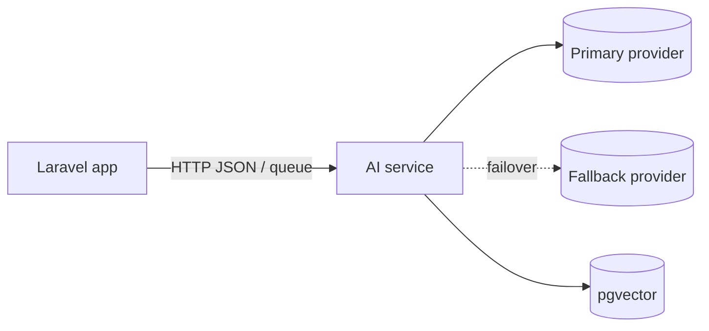

# <Project> — AI architecture

> Read before adding or changing any model call. Decisions cite their driver: `(SPEC R7)`, `(LEARNINGS YYYY-MM-DD)`, `(default)`, `(developer)`.

## Features
| ID | Feature | Serves | Pattern | Tier | Runs | Non-AI fallback | Eval gate | Card | Status |
|---|---|---|---|---|---|---|---|---|---|
| F1 | <invoice field extraction> | R4 | extraction | standard | queued | <manual entry form> | <fields ≥ 90%, schema 100%> | [card](features/F1-invoice-extraction.md) | live |

## Where AI code lives
<Laravel AI SDK in app/Ai · FastAPI AI service at services/ai · split — and why>

## Providers and model tiers
| Tier | Primary | Fallback | Used for |
|---|---|---|---|
| fast | | | classification, routing |
| standard | | | extraction, summaries |
| smart | | | reasoning, agents |
Configured in: <config/ai.php · settings.py> — features reference tiers, never model names.

## Prompts
Location: <app/Ai/Agents/* instructions() · services/ai/prompts/*.md> · versioning: <PROMPT_VERSION constant / file hash> · change rule: eval run required.

## Context and knowledge
<direct context / RAG (embedding model, chunking, store, refresh) / tools>

## Evals
Location `evals/ai/<F-id>/` · runner · merge threshold per feature · production sampling rate.

## Safety and privacy
Injection defense · PII rules · data residency · human review points · moderation.

## Execution
| Feature | Mode | Timeout | Retries | Idempotency key |
|---|---|---|---|---|

## Observability and cost
Per-call log fields · where logs go · budget per feature/month · alert thresholds · caching.

## Change management
Model/prompt rollout: eval gate → shadow/flag → full. Upgrade log below.

## Open questions
| Question | Owner | Blocks |
|---|---|---|

## Model and prompt changes
| Date | Feature | Change | Eval before → after | Decision |
|---|---|---|---|---|
