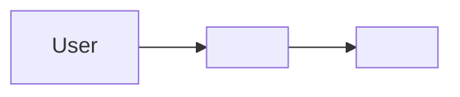
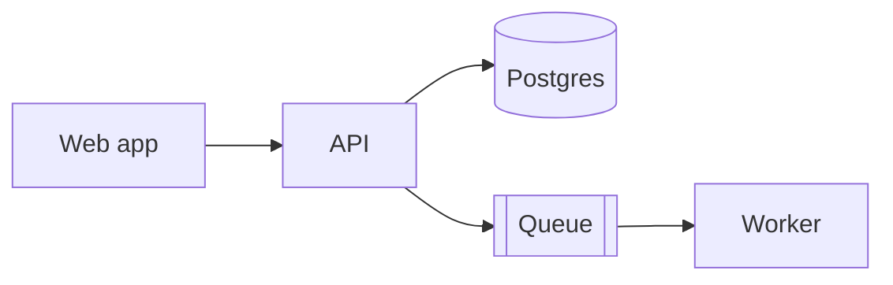
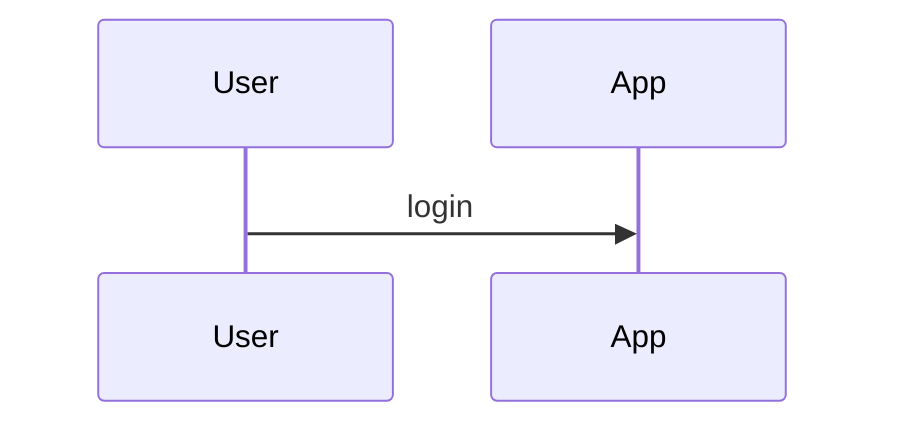

# <Project name> — Architecture

> Source of truth for how this system is built. Read before changing module or service boundaries.
> Last updated: <YYYY-MM-DD> · Owner: <name>

## Summary
- **What it is:** <one sentence>
- **Repo shape:** <monorepo/polyrepo + tool>
- **Service shape:** <modular monolith / services list>
- **Auth:** <mechanism + provider>
- **Primary data store:** <db>
- **Hosting:** <platform>

## 1. Drivers
| Driver | Value |
|---|---|
| Users / actors | |
| Scale at launch → 12 months | |
| Team size | |
| Availability · RPO · RTO | |
| Compliance | |
| Top quality attributes (ranked) | |

## 2. Context diagram

## 3. Container diagram

## 4. Repository layout
<tree + what goes where + shared-code policy>

## 5. Modules / services
| Module | Responsibility | Owns data | Depends on | Status |
|---|---|---|---|---|

**Dependency rules:** <allowed directions> · **Enforced by:** <tool>

## 6. Domain model
<core entities, owner module, ID strategy>

## 7. Authentication
<provider, login methods, MFA, session/token per client, lifetimes, revocation, service identity>

## 8. Authorization
<model, enforcement layer, policy location, tenant isolation, audit>

## 9. Data
<stores and why, ownership, migrations rule, backups, retention, PII>

## 10. APIs and contracts
<style per boundary, contract source, versioning, errors, pagination, rate limits>

## 11. Async, events, integrations
<queues, events, scheduled jobs, third parties + fallbacks, webhooks>

## 12. Frontend / clients
<rendering, data fetching, design system>

## 13. Infrastructure and environments
<hosting, envs, IaC, regions, config and secrets>

## 14. Delivery
<branching, CI gates, deploy strategy, flags, rollback>

## 15. Observability
<logs, metrics + SLIs, tracing, error tracking, alert routing>

## 16. Reliability
<failure mode per dependency, timeouts/retries, degradation>

## 17. Security baseline
<top threats, encryption, validation layer, scanning, audit log>

## 18. Testing strategy
<pyramid per module, test DB, merge gates>

## 19. Cost
<estimate now / 12 months, biggest driver, alert>

## Decisions
| ADR | Title | Status |
|---|---|---|

## Open questions
| Question | Owner | Blocks by | Recommended answer |
|---|---|---|---|

## Planned evolution
| Change | Trigger condition |
|---|---|
