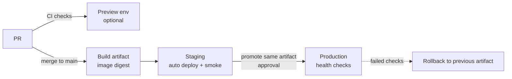

# Pipeline stages

| Stage | Trigger | Runs | Exit criteria |
|---|---|---|---|
| **PR** | push to branch | format, lint, types, tests, security scans, PR-title check, scoped mutation/contract/AI evals | all required checks green + review approval |
| **Preview** (optional) | PR opened | deploy branch to an ephemeral env with seeded data | reviewer can click through; destroyed on merge |
| **Build** | merge to `main` | build once → tagged image/bundle (git SHA) → push to registry | artifact digest recorded |
| **Staging** | build done | deploy artifact, run migrations, E2E smoke, nightly k6 | smoke green; no error-rate spike for 10 min |
| **Production** | manual approval (or auto after staging soak, for mature teams) | deploy same artifact; migrations (expand only); health checks | health + SLO burn rate normal for 15–30 min |
| **Rollback** | failed health/SLO or manual | redeploy previous artifact; feature flag off | service back to previous behaviour |

Smaller projects: PR → main → staging → prod can be one workflow; keep the order and gates.
