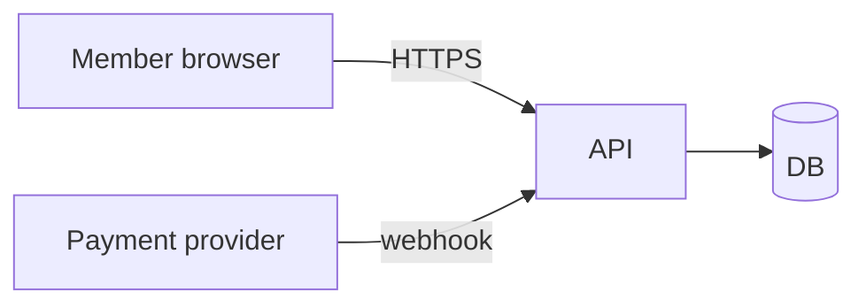

# Threat model — <feature>

## Scope and actors
<what the feature does; who interacts: member, admin, anonymous, external service, AI agent>

## Data flow

Trust boundaries: <browser↔API · API↔provider · tenant↔tenant · user text↔AI>

## Assets
<accounts, money, PII, other tenants' data, admin rights, compute/AI spend>

## Threats
| # | Boundary | STRIDE | Threat | Mitigation | Proof (test/config) | Status |
|---|---|---|---|---|---|---|
| 1 | provider → API | Spoofing | Fake webhook marks booking paid | Verify HMAC signature + 5-min timestamp | `test_rejects_unsigned_webhook` | mitigated |
| 2 | member → API | Elevation | Member cancels another member's booking | Policy check on booking owner | `test_other_member_gets_403` | mitigated |

STRIDE prompts: **S**poofing — can someone pretend to be a user/service? **T**ampering — can data be changed in transit or at rest? **R**epudiation — can someone deny an action (is it logged)? **I**nformation disclosure — can data leak to the wrong user/tenant/log? **D**enial of service — can someone exhaust resources or spend? **E**levation — can someone gain rights they shouldn't?

## Accepted risks
| Threat # | Why accepted | Review by |
|---|---|---|
